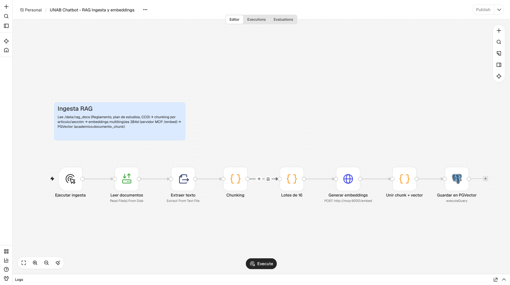

# Chatbot de apoyo académico UNAB — Ingeniería de Sistemas

Chatbot híbrido **RAG + agentes MCP** orquestado en **n8n**, con **Supabase (PostgreSQL + pgvector)**, servidor **MCP en FastMCP** y **app Android (Gradio PWA)**, desplegado en **AWS EC2**.
Datos de estudiantes **sintéticos** que simulan Banner/COSMOS. Normas reales: Reglamento Estudiantil de Pregrado UNAB (2019), plan de estudios de Ingeniería de Sistemas (programa 1791) y Centro de Competencias Digitales (CCD).

## Estructura

| Carpeta | Contenido |
|---|---|
| `db/` | `01_schema.sql`, `02_views.sql` (reglas del reglamento en SQL), `03_seed.sql` (300 estudiantes), `04_calendario.sql`, `generar_datos_sinteticos.py`, `calendario_academico.csv` |
| `rag_docs/` | Documentos para RAG: reglamento, plan de estudios, artículos del CCD |
| `mcp_server/` | Servidor MCP FastMCP (`server.py`), embeddings locales, chunker, scraper, ingesta RAG, Dockerfile |
| `n8n/` | `build_workflows.py` y los 3 workflows importables en `workflows/` |
| `app/` | App Gradio (PWA instalable en Android) |
| `android/` | Proyecto Android Studio (WebView) para generar APK |
| `deploy/` | `setup_ec2.sh`, `cargar_bd.sh`, `importar_n8n.sh`, `ingestar_rag.sh`, `Caddyfile` |
| `docs/` | Guion del video y fuentes originales |
| `tests/` | `mock_anthropic.py` (simulador de la API de Claude para pruebas sin API key) |

## Despliegue rápido (EC2 Ubuntu 24.04)

```bash
git clone <repo> chatbot-unab && cd chatbot-unab      # o copiar la carpeta por scp
bash deploy/setup_ec2.sh                               # swap, Docker, dominio sslip.io, claves
nano .env                                              # DATABASE_URL, ANTHROPIC_API_KEY, CALENDARIO_CSV_URL
bash deploy/cargar_bd.sh                               # esquema + datos sintéticos en Supabase
sudo docker compose up -d --build
bash deploy/importar_n8n.sh                            # credenciales + workflows
bash deploy/ingestar_rag.sh                            # (o ejecutar el workflow de ingesta en n8n)
```

Security Group: 22 (tu IP), 80, 443 y 9000 abiertos.

## Capturas del proceso

### Workflows en n8n
**Workflow principal**: guardrails, ruteo por intención, 4 rutas, agente Claude con memoria y servidor MCP.


**Ingesta RAG**: chunking, embeddings y PGVector.


**Scraper de noticias** (programado cada 6 h).


**Ejecución exitosa** del workflow principal (ruta historial personal con herramientas MCP).


### App móvil (Gradio PWA)
| Login | Login rechazado | Sesión iniciada |
|---|---|---|
|  |  |  |

<!-- CAPTURAS_DESPLIEGUE -->

## Usuarios de demo

| ID | Nombre | Perfil |
|---|---|---|
| U00174957 | Valentina Rojas Méndez | Semestre 6, PGA 4.17, falta inglés B2 |
| U00160001 | Andrés Felipe Gómez Pardo | Condicional |
| U00160002 | Laura Camila Suárez Díaz | Prueba académica |
| U00160003 | Santiago Pérez Villamizar | Primer semestre |
| U00160004 | María José Ardila Castro | Semestre 8, PGA 4.47 |

## Conectar Claude Desktop al servidor MCP

```json
{ "mcpServers": { "unab-academico": { "command": "npx", "args": ["mcp-remote", "https://mcp.<ip>.sslip.io/mcp"] } } }
```
